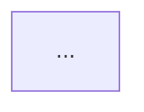

The point of these diagrams is that someone new to the repo can trust them. A diagram that invents a service or misses the database is worse than none, so everything here is about drawing what the code actually shows.

## 1. Survey before drawing

Run `scripts/survey.py` (paths in this skill are relative to its folder) against the repo root:

```sh
python3 scripts/survey.py /path/to/repo > /tmp/mermaid-survey.txt
```

It lists modules with file counts, manifests, entry points, external services found in declared dependencies, data model sources, and the import graph between modules with counts. Each import edge comes from real import statements, so use those edges as the backbone of the architecture diagram. If one module holds most of the code and needs splitting, rerun with `--depth 3`.

Then read what the script can't see:

- the README and any existing docs, for the names the team already uses
- entry points, to see what runs as its own process (servers, workers, CLIs, cron jobs, lambdas)
- deploy config (Dockerfile, compose files, fly.toml, serverless/CDK, Terraform), for what's deployed separately and what it talks to
- calls that cross a process boundary: HTTP clients and base URLs, queue publishers and consumers, SDK clients for external services

Keep a short note of which file supports each box and arrow. It becomes the Sources list in the output.

If the user asks for just one diagram ("an ER diagram of our database"), make only that one, but still survey first.

## 2. Architecture overview

Draw a `flowchart` of the deployable pieces and the modules inside them, plus the data stores and outside services they use. Aim for 6 to 20 nodes. A bigger repo gets grouped into subgraphs per deployable unit, not more boxes.

- **Nodes are things a developer would name**: "API server", "web app", "firehose consumer", "PostgreSQL", "Stripe". Use the team's names from the README or package names.
- **Arrows point from caller to callee**, and say how when it crosses a process ("REST /api", "SQL", "S3 upload"). Leave in-process imports unlabeled.
- **Drop what doesn't explain the system**: utility modules everyone imports, types-only packages, tests, build scripts. Mention them in the text if they matter.
- **Don't draw what you can't point to.** If you suspect a connection but can't find the code for it, leave it out and say so in the text.

Shape and style conventions are in [references/diagram-guide.md](references/diagram-guide.md).

## 3. Data model

Draw an `erDiagram` only when the survey lists data model sources; with none, say so in one sentence and skip it. Don't infer tables from API types or variable names, because a guessed schema looks exactly as authoritative as a real one.

- **Migrations are the truth** when they exist. Apply them in order, so later `ALTER`, `DROP`, and renames win. If ORM models disagree with the migrations, follow the migrations and note the mismatch.
- **Two sets of migrations** (say, an old `supabase/migrations/` and a live `drizzle/` folder) usually means one is stale. Follow the one the app's migrate command or ORM config points at (`drizzle.config.*`, `prisma/schema.prisma`, the `migrate` script in package.json), and name the stale one in the text.
- **Show keys and the columns that identify a row**: primary keys, foreign keys, unique columns, and a few columns a reader needs to recognize the entity. Skip timestamps and other bookkeeping columns unless they matter.
- **Read cardinality from the constraints.** A non-null foreign key is exactly one on the parent side, a nullable one is zero or one, and a unique foreign key makes the relationship one-to-one. Label each relationship with a short verb phrase.
- Past about 15 entities, split the diagram by domain instead of drawing one wall of tables.

## 4. Write the file

Write `docs/architecture.md`, or update it if it exists. If the repo keeps docs somewhere else, follow that, and if the user named a path, use theirs. For each diagram:

````markdown
## Architecture

Two or three sentences on what the diagram shows and anything it leaves out.

<!-- mermaid-gen:start architecture -->

<!-- mermaid-gen:end architecture -->

**Sources:** `cmd/server/main.go`, `internal/handler/`, `fly.toml`
````

The marker comments let a later run replace just the diagram without touching prose someone edited by hand. When updating an existing file, change only what's between markers, plus the explanation and sources directly around them.

## 5. Check it renders

Run `scripts/lint_mermaid.py` on the file:

```sh
python3 scripts/lint_mermaid.py /path/to/repo/docs/architecture.md
```

It catches the mistakes that most often break rendering: special characters in unquoted labels, reserved words like `end` as node ids, an unclosed `subgraph`, and malformed ER relationships or attributes. Fix every error before finishing. If `mmdc` (mermaid-cli) is installed, render with it too.

Finish by telling the user where the file is, what each diagram covers, and anything you left out or couldn't confirm.
