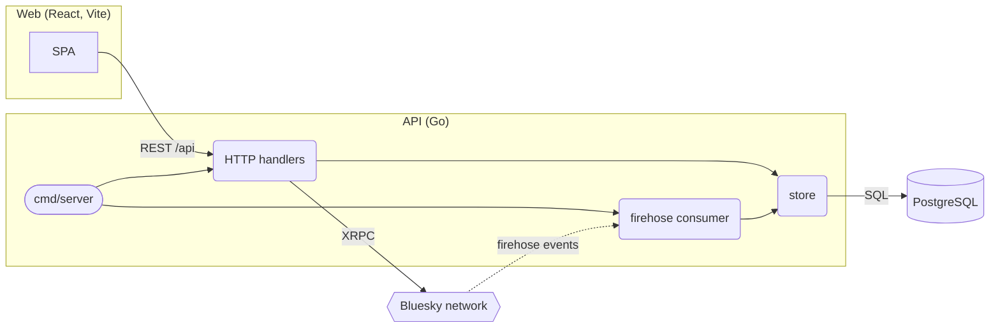
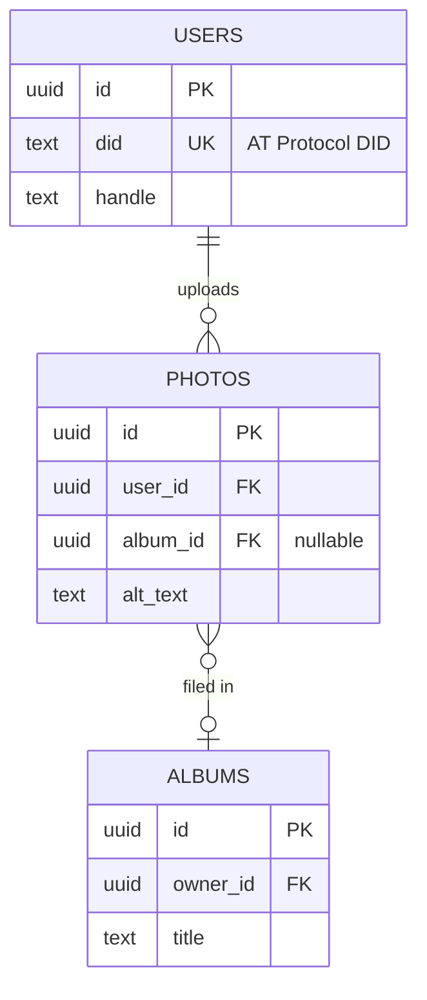

# Diagram guide

Conventions for the two diagrams `mermaid-gen` writes. Consistent shapes let a reader learn the legend once and read any repo's diagram the same way.

## Architecture flowchart

Use `flowchart LR` for systems that read left to right (client, API, storage) and `flowchart TB` for layered ones (entry points on top, storage at the bottom).

| Thing | Shape | Syntax |
|-------|-------|--------|
| Deployable app, service, worker | rectangle | `api["API server"]` |
| Entry point a person starts (CLI, cron job) | stadium | `cli(["picsky backfill"])` |
| Module inside a deployable | rounded | `handlers("HTTP handlers")` |
| Database, cache, bucket | cylinder | `db[("PostgreSQL")]` |
| Queue or stream | parallelogram | `queue[/"jobs queue"/]` |
| External service you don't run | hexagon | `stripe{{"Stripe"}}` |
| Group: one deployable, or one network boundary | subgraph | `subgraph api_svc["API (Go, fly.io)"] ... end` |

Edges:

- `-->` for a call or dependency, pointing from caller to callee.
- `-.->` for async or event-driven flow (publish, webhook, firehose).
- `-->|"label"|` names the protocol when the edge crosses a process boundary: `"REST /api"`, `"SQL"`, `"gRPC"`, `"S3 PUT"`.

Ids and labels:

- Ids are short, lowercase, and unique: `web`, `api`, `db`. Never use `end`, `graph`, `subgraph`, `class`, `style`, or `click` as an id.
- Quote every label: `api["API server"]`. Quoting is what lets labels hold parentheses, slashes, and colons safely.
- Keep labels to a few words. Put the language or platform in the subgraph title, not in every node.

Example:

## ER diagram

Rules that keep it rendering:

- Entity names are one word: letters, digits, underscores, hyphens. Use the table name as written in the schema.
- Attribute lines are `type name`, then optional `PK`, `FK`, or `UK` (comma-separated if more than one), then an optional quoted comment. The type can't contain spaces, so write `character varying` as `varchar` and `timestamp with time zone` as `timestamptz`.
- Relationships are `A <left><line><right> B : "label"`. Quote the label if it has spaces.

Cardinality markers, read from each table's side:

| Marker (left / right) | Meaning | Use when |
|-----------------------|---------|----------|
| `\|\|` / `\|\|` | exactly one | the FK is `NOT NULL` (on the parent side) |
| `\|o` / `o\|` | zero or one | the FK is nullable, or a unique FK (one-to-one) |
| `}\|` / `\|{` | one or more | rare in schemas; only when enforced |
| `}o` / `o{` | zero or more | the child side of an ordinary FK |

`--` is an identifying relationship (the child's key includes the parent's key) and `..` is non-identifying. Most foreign keys are non-identifying, but plenty of diagrams use `--` throughout for readability, and that's fine as long as you're consistent.

## Reading schemas

- **SQL migrations**: replay them in filename order. Track `CREATE TABLE`, `ALTER TABLE ... ADD/DROP/RENAME COLUMN`, `ADD CONSTRAINT ... FOREIGN KEY`, `DROP TABLE`, and `CREATE UNIQUE INDEX` (which makes a column `UK`).
- **Prisma**: models are entities. `@id` is PK, `@unique` is UK, and a field with `@relation(fields: [...])` is the FK side.
- **Drizzle / TypeORM / SQLAlchemy / Django / ActiveRecord**: tables or classes are entities, and `references()`, `ManyToOne`, `ForeignKey`, `belongs_to` mark the FK side.
- **Join tables** (two FKs, little else) can be drawn as a many-to-many line between the two parents with the join table named in the label, which is easier to read than a third box.
